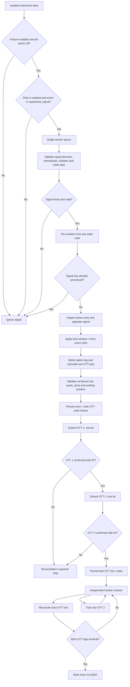
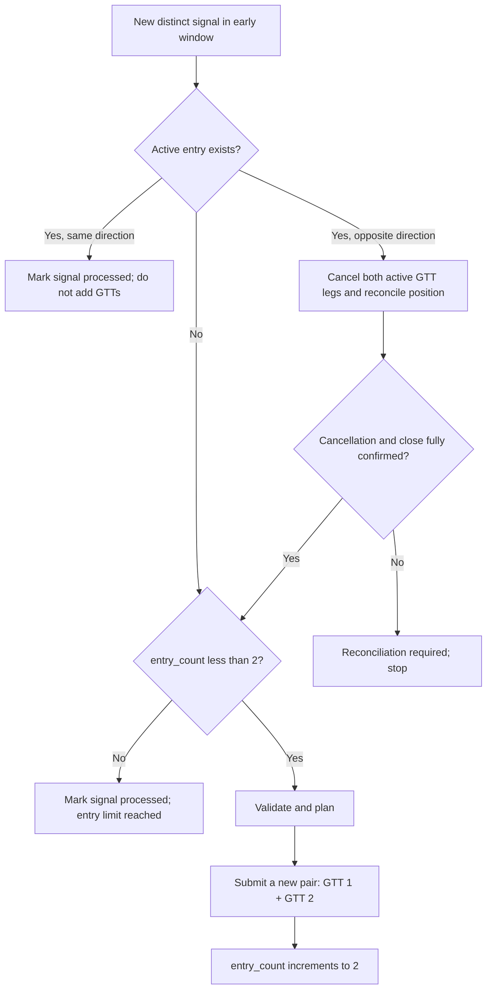
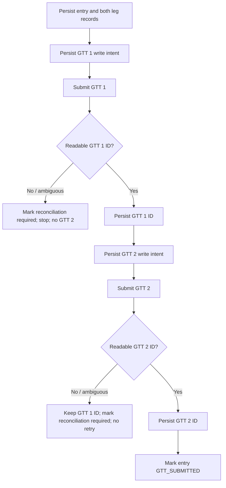
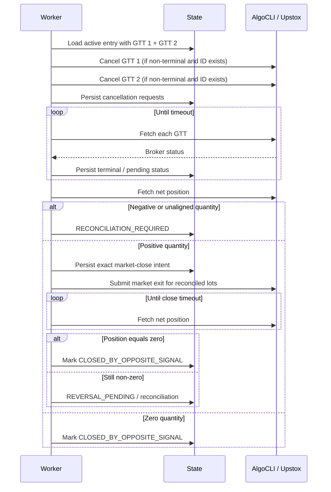
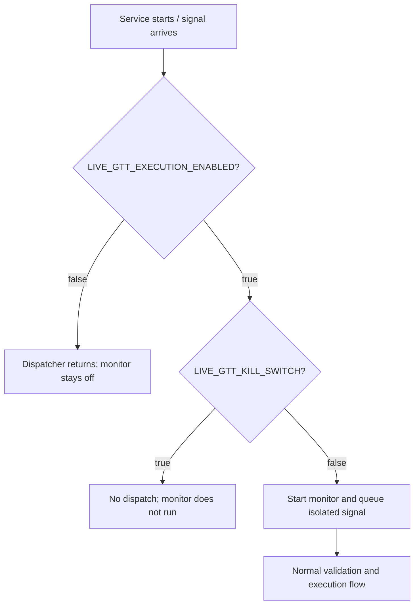

# Live Supertrend Two-GTT Execution — Architecture and Scenario Catalogue

> **Scope:** This document describes the implementation currently present in `isolation_v1`.
> It is an operational architecture reference, not an instruction to enable live trading.
> Times below are India Standard Time (IST). Configuration values are the current code defaults
> and can be overridden through the environment.

## 1. Strategy at a glance

One accepted Supertrend signal for one isolated instrument creates **one entry set** containing
**two separate GTT orders**. Each GTT is exactly one lot:

| Feature | GTT 1 — Existing | GTT 2 — Trailing |
|---|---|---|
| Orders per accepted signal | 1 | 1 |
| Quantity | 1 lot | 1 lot |
| Entry | Immediate live-market entry | Immediate live-market entry |
| Initial stop | Existing percentage-stop then nearest support below that stop | Lower of 30% percentage stop and nearest S1/S2/S3 support below entry |
| Target | Existing premium-band target (60 / 50 / 40 points) | Completed 15-minute R3; otherwise GTT 1 target **price × 5** |
| Trailing | No | Yes |
| Trailing step | — | Fixed from initial entry, initial GTT 2 SL and initial GTT 2 target |
| Independent management | Yes | Yes |

**Important counting distinction:** entry limits count *entry sets/signals*, not individual GTTs.
Two accepted entry sets in the early window mean four GTT orders in total (two GTTs in each set),
subject to the active-entry, signal-deduplication, position and risk gates below.

## 2. High-level architecture



### Component responsibilities

| Component | Responsibility |
|---|---|
| Isolated feed dispatcher | Filters for enabled execution, isolated role and `supertrend_signal`; queues work without making broker calls on the feed/socket thread |
| Single worker | Serializes signal processing; per-isolation lock protects the state decision |
| Signal validator | Direction, signal time, frame receive time, isolation lookback and trade-date checks |
| State store | Loads/saves isolation state in MongoDB with local JSON fallback; saves local state atomically |
| Strategy planner | Selects bullish isolated leg or bearish opposite leg; fetches LTP and pivot levels; calculates two independent GTT plans |
| Risk gate | Checks positive configured caps and combined two-GTT notional and initial risk; rejects pre-existing position on selected contract |
| AlgoCLI adapter | Runs broker reads/writes through the installed AlgoCLI skill contract |
| GTT monitor | Polls each GTT, confirms linked exit orders, and trails only GTT 2 |
| Audit service | Persists action prompts, requests, responses and outcomes |
| Telegram routing | Detailed audit to configured private chat; selected lifecycle summaries to configured group |

## 3. Time windows and entry-count rules

Current defaults from `core/config.py`:

| Setting | Default | Meaning |
|---|---:|---|
| `LIVE_GTT_EARLY_ENTRY_START` | 09:15 | Start of early entry window |
| `LIVE_GTT_EARLY_ENTRY_END` | 09:39:59 | Inclusive end of early entry window |
| `LIVE_GTT_EARLY_MAX_ENTRIES` | 2 | Maximum entry sets allowed by the early-window limit |
| `LIVE_GTT_LATE_ENTRY_START` | 09:40 | Start of late entry window |
| `LIVE_GTT_LATE_MAX_ENTRIES` | 1 | Maximum entry sets allowed by the late-window limit |
| `LIVE_GTT_LATE_ALLOW_REVERSAL` | false | Whether a late opposite signal may proceed to the reversal entry-count gate |
| `LIVE_GTT_MAX_SIGNAL_AGE_SECONDS` | 120 | Maximum signal age |
| `LIVE_GTT_MAX_FRAME_AGE_SECONDS` | 5 | Maximum feed-frame age |
| `LIVE_GTT_ISOLATION_LOOKBACK_SECONDS` | 60 | Permitted signal lookback relative to isolation |
| `LIVE_GTT_MONITOR_INTERVAL_SECONDS` | 3 | GTT monitor polling interval |

The configured window function returns:

```text
09:15:00 through 09:39:59  -> early limit (default 2)
09:40:00 onward            -> late limit (default 1)
Before 09:15:00            -> no entry (limit 0)
09:39:59 to 09:40:00 gap   -> no gap; the early end is inclusive and late starts at 09:40
```

There is a **non-entry interval** after the early window ends and before the late window
starts only if operators change the configured values so that a gap exists. With the defaults,
the windows meet at 09:40.

### Critical implementation detail: the count is cumulative per isolation state

`entry_count` is incremented when an entry set is created and is not decremented when that
entry later closes. The code compares this cumulative count to the limit returned for the
current time. Therefore:

- Two early entry sets can be created if both fit within the early limit and the prior entry
  is no longer active.
- A late-window limit of one does **not** mean one additional late entry after early entries.
  If `entry_count` is already one or two, it is already at or above the late limit of one.
- Under the default limits, an isolation that has already created one early entry set cannot
  create another entry set at or after 09:40. An isolation with two early entry sets cannot
  create any further entry set that day.
- Entry count is associated with the isolation state, not a global account-wide daily counter.

This cumulative behavior is what the current code implements. It should not be interpreted as
“two early entries plus one additional late entry.”

## 4. Signal acceptance and rejection gates

Every incoming signal passes the following checks before order planning:

1. `LIVE_GTT_EXECUTION_ENABLED` must be true and `LIVE_GTT_KILL_SWITCH` must be false.
2. Role must be `isolated`; payload event must be `supertrend_signal`.
3. Direction must resolve to bullish or bearish.
4. Signal timestamp, received timestamp, isolation timestamp and source instrument key must exist.
5. Record trade date must match today's IST date.
6. Signal cannot be older than the configured isolation lookback relative to the isolation touch/create time.
7. Signal age must be between approximately -2 seconds and the configured maximum (default 120 seconds).
8. Frame age must be between approximately -2 seconds and the configured maximum (default 5 seconds).
9. The generated signal key (source instrument + direction + signal timestamp) must not already be processed.
10. The per-isolation active-entry/reversal rules and time-window entry-count gate must pass.
11. Selected contract metadata must contain instrument key, lot size and tick size.
12. Quote age must be within the configured quote freshness limit (default 10 seconds).
13. Both pivot inputs and target/stop calculations must be valid under the planner's rules.
14. `LIVE_GTT_LOTS_PER_ORDER` must equal exactly one.
15. Both notional and risk caps must be positive and combined exposure must be within both caps.
16. The selected contract must not already have a non-zero position.

A rejected/blocked plan is logged and recorded as an `EXECUTION_BLOCKED` audit event; detailed
audit notification is routed to the private Telegram chat when configured.

## 5. Entry-window scenarios

### Scenario A — Signal before 09:15

- No new entry set is permitted because the entry-limit function returns zero.
- If there is no active entry, the signal is marked processed and no GTT is placed.
- If an active entry exists and an opposite signal arrives, the current implementation evaluates
  the active-entry/reversal branch before applying the new-entry time limit. See Scenario H.

### Scenario B — First valid signal between 09:15 and 09:39:59

```mermaid
sequenceDiagram
    participant Feed
    participant Worker
    participant State
    participant Planner
    participant Broker as AlgoCLI / Upstox
    participant TG as Telegram
    Feed->>Worker: isolated supertrend_signal
    Worker->>Worker: Validate timestamps, direction, trade date
    Worker->>State: Load isolation state; dedupe signal
    State-->>Worker: No active entry; entry_count = 0
    Worker->>Worker: Early window; limit = 2
    Worker->>Planner: Select contract and calculate GTT 1 + GTT 2
    Planner-->>Worker: Combined risk checks pass
    Worker->>State: Persist entry and GTT 1 write intent
    Worker->>Broker: Place GTT 1 (1 lot)
    Broker-->>Worker: GTT 1 response + ID
    Worker->>State: Persist GTT 1 ID
    Worker->>State: Persist GTT 2 write intent
    Worker->>Broker: Place GTT 2 (1 lot)
    Broker-->>Worker: GTT 2 response + ID
    Worker->>State: Persist GTT 2 ID; mark submitted
    Worker->>TG: Private audit + group entry summary
```

Result: one entry set, two independent GTTs, two lots total (one lot per GTT).

### Scenario C — Second valid entry set in the early window

A second entry set is possible only when all of the following are true:

- Current time remains within 09:15–09:39:59.
- `entry_count` is still below two.
- The previous entry is no longer active according to the active-entry status list. In normal
  successful completion this means both of its GTT legs have reached terminal states and the
  monitor has marked the entry `CLOSED`.
- The new signal has a new signal key and passes all freshness, isolation, risk and position checks.
- The selected contract has no unrelated pre-existing position.



**Example:** First pair closes at 09:24; a distinct second signal arrives at 09:31. If all gates
pass, the worker can create the second pair. That produces four GTT placements across the two
entry sets, not four GTTs for one signal.

### Scenario D — Same-direction signal while a pair is active

- The current active entry has the same `signal_direction`.
- The new signal key is marked processed and saved.
- No additional GTT pair is created.
- This prevents repeated same-direction signal frames from stacking another entry while the
  existing pair is active.

### Scenario E — Opposite signal during the early window

1. Both non-terminal GTT legs are sent cancellation requests.
2. Each GTT is polled until it is confirmed terminal (cancelled, completed, expired or rejected).
3. The actual net position is read.
4. Negative position, ambiguous GTT cancellation, unreadable state, or timeout blocks automation.
5. If a positive position exists, quantity must be an exact multiple of the known lot size.
6. The exact reconciled quantity is closed using a market exit.
7. The position must reconcile to zero before the new direction is considered.
8. The early entry-count gate is applied.
9. If capacity remains, a fresh two-GTT pair is planned and submitted for the opposite direction.

If the previous entry already consumed the second early slot, the old position may be closed
but the new pair is blocked by the entry-count limit. Reversal is not an exemption from the cap.

### Scenario F — Signal at or after 09:40 with no active entry

- The late limit is one entry set.
- The cumulative `entry_count` must be below one.
- If no entry set has yet been created for that isolation, a late signal can create one two-GTT pair.
- If any earlier entry set was already created, the cumulative count is at least one and the
  late signal is blocked.
- The late limit does not reset the counter.

### Scenario G — Opposite signal at or after 09:40; late reversal disabled (default)

When an active entry exists and an opposite signal arrives at/after the configured late start:

1. The code detects late time and `LIVE_GTT_LATE_ALLOW_REVERSAL=false`.
2. It cancels both GTT legs and reconciles/ closes the position.
3. If closure is confirmed, the signal is marked processed.
4. It returns without placing a new opposite-direction pair.

Thus **late opposite signal = close existing exposure, do not reverse into a new pair** under
the default setting. If cancellation or close cannot be confirmed, state is marked for
reconciliation and no new pair is submitted.

### Scenario H — Opposite signal outside an entry window

The current processing order handles an active opposite entry before it checks the entry limit.
Therefore, if operators configure a gap between the early end and late start:

- With an active entry, an opposite signal in the gap can cancel both GTTs and close the position.
- After the close, the entry-limit function returns zero and no new pair is submitted.
- With no active entry, a signal in the gap is simply blocked by the zero entry limit.

This is a close-only safety outcome, not a new entry window.

### Scenario I — Late reversal flag set true

If `LIVE_GTT_LATE_ALLOW_REVERSAL=true`, the explicit late close-only branch is skipped.
The worker then cancels/closes the current entry and applies the normal late limit.
Because the counter is cumulative and an active entry normally means at least one entry set
has already been counted, the late limit of one will normally block the new pair.

**Do not assume that enabling this flag creates an additional late reversal slot.** The current
counter semantics still apply. A separate policy change would be required if the desired rule
is “one early entry allowance plus one additional late reversal allowance.”

## 6. Time-window scenario matrix

| Current IST time | Active entry? | Incoming signal | Current implementation outcome |
|---|---|---|---|
| Before 09:15 | No | Any valid direction | No entry; limit is zero |
| 09:15–09:39:59 | No, count 0 | New signal | May create one two-GTT pair |
| 09:15–09:39:59 | No, count 1 | New distinct signal | May create second two-GTT pair |
| 09:15–09:39:59 | No, count 2 | New signal | Blocked by early cap |
| 09:15–09:39:59 | Yes | Same direction | Mark processed; no new pair |
| 09:15–09:39:59 | Yes | Opposite direction | Cancel both, reconcile/close, then create pair only if early cap remains |
| 09:40 onward | No, count 0 | New signal | May create one two-GTT pair |
| 09:40 onward | No, count ≥1 | New signal | Blocked by cumulative late cap |
| 09:40 onward | Yes | Same direction | Mark processed; no new pair |
| 09:40 onward | Yes | Opposite direction; reversal false | Cancel both and close; no new pair |
| 09:40 onward | Yes | Opposite direction; reversal true | Cancel/close; then late count gate normally blocks a new pair |
| Any time | Yes, state ambiguous | Any new signal | Blocked; manual reconciliation required |
| Any time | No active entry | Duplicate signal key | Ignored; no new pair |

## 7. Two-GTT placement and partial-failure scenarios

Each entry set is persisted before broker writes. The worker then submits GTT 1 and GTT 2
sequentially, each with one lot and a distinct deterministic operation reference.



| GTT 1 outcome | GTT 2 outcome | Persisted interpretation | Automated action |
|---|---|---|---|
| Confirmed with ID | Confirmed with ID | Both legs submitted | Monitor both independently |
| Missing ID / ambiguous | Not attempted | Reconciliation required | No retry; reconcile broker first |
| Failed / ambiguous | Not attempted | Reconciliation required | No retry; reconcile broker first |
| Confirmed with ID | Missing ID / ambiguous | Partial pair; GTT 1 ID retained | Reconciliation required; do not duplicate GTT 1 or retry GTT 2 |
| Confirmed with ID | Failed / ambiguous | Partial pair; first leg retained | Reconciliation required |
| Confirmed with ID | Confirmed but state save fails | Persistence failure / uncertain local state | Stop automation and reconcile Mongo, local state and broker |

The code intentionally does not automatically cancel a confirmed first GTT merely because the
second GTT write failed. This avoids introducing another ambiguous broker write. An operator
must reconcile the actual broker state and decide the recovery action.

## 8. Per-GTT lifecycle and trailing architecture

```mermaid
stateDiagram-v2
    [*] --> WRITE_NOT_STARTED
    WRITE_NOT_STARTED --> WRITE_INTENT_PERSISTED
    WRITE_INTENT_PERSISTED --> GTT_SUBMITTED: broker response includes GTT ID
    WRITE_INTENT_PERSISTED --> RECONCILIATION_REQUIRED: ambiguous / missing ID
    GTT_SUBMITTED --> OPEN: monitor sees active GTT
    OPEN --> OPEN: no terminal exit; GTT still protects position
    OPEN --> TARGET_FILLED: target rule + linked exit order confirmed
    OPEN --> STOPLOSS_FILLED: stop rule + linked exit order confirmed
    OPEN --> CANCELLED: broker confirms cancellation
    OPEN --> EXPIRED: broker confirms expiry
    OPEN --> REJECTED: broker confirms rejection
    OPEN --> RECONCILIATION_REQUIRED: unreadable or unidentifiable broker state
    TARGET_FILLED --> [*]
    STOPLOSS_FILLED --> [*]
    CANCELLED --> [*]
    EXPIRED --> [*]
    REJECTED --> [*]
```



### GTT 1

- Its SL and target are not trailed by this monitor.
- It is polled independently from GTT 2.
- A target/stop event is only treated as a confirmed fill when the matching linked exit order
  is found and its order status is complete/filled.
- A GTT terminal status without an identifiable exit rule/order is not called a fill; it requires
  reconciliation.

### GTT 2

- Trailing is considered only while GTT 2 is active and neither its target nor stop rule is
  already triggered.
- The monitor obtains a fresh LTP; stale quote response skips that monitor cycle.
- The step is fixed once at plan time:

```text
trail_step = (initial_entry - initial_GTT2_SL)
             + ((initial_GTT2_target - initial_entry) / 2)
```

- For each full favourable step above the original entry, the stop is advanced by one full step:

```text
completed_steps = floor((LTP - initial_entry) / trail_step)
desired_SL = initial_GTT2_SL + completed_steps * trail_step
```

- The desired SL is compared against the currently confirmed SL. It must be strictly higher
  by more than half a tick; it can never move down or loosen.
- The update intent is persisted before the broker write.
- Only the STOPLOSS rule is requested to be changed; the existing target rule is to remain intact.
- The broker GTT is fetched again and the actual STOPLOSS trigger must match the requested
  value within half a tick before state is advanced and the group notification is sent.
- A pending/ambiguous/unverified update blocks future automatic trail changes and marks the
  entry for reconciliation. No blind retry or cancel/recreate fallback is performed.

Example: entry 100, GTT 2 initial SL 70, target 140 → fixed step 50.

| LTP | Completed favourable steps | Desired GTT 2 SL |
|---:|---:|---:|
| 149 | 0 | 70 |
| 150 | 1 | 120 |
| 200 | 2 | 170 |
| 249 | 2 | 170 |
| 250 | 3 | 220 |

## 9. Position completion and independent exits

Each GTT has its own broker ID, target, stop and terminal state.

- If GTT 1 exits while GTT 2 remains active, the entry remains active and GTT 2 continues to
  be monitored/trailing as applicable.
- If GTT 2 exits while GTT 1 remains active, GTT 1 continues to be monitored independently.
- Only when **all** stored GTT legs are marked terminal does the entry become `CLOSED`.
- A confirmed target exit generates a target-confirmed group event.
- Once all legs are terminal, a position-completed group event is generated.
- The code does not assume GTT submission equals fill; linked orders are checked separately.

## 10. Opposite-signal cancellation and close flow



Cancellation is not treated as proof that no position exists. The worker reads actual net quantity
after GTT terminal confirmation, closes only a positive reconciled quantity, and waits for zero.
Unexpected short quantity, a quantity not divisible by known lot size, timeout or ambiguous
write prevents automatic reversal.

## 11. State, audit, logs and Telegram

### State persistence

- State key: isolation ID (trade date + isolated source instrument key).
- Mongo collection: `LIVE_GTT_STATE_COLLECTION` (default `live_gtt_execution_state`).
- Local fallback: `LIVE_GTT_STATE_DIR` (default `data/live_gtt_state`).
- Each entry stores the two GTT leg records independently, including GTT ID, lot/unit quantity,
  strategy, initial/current stop, target, broker status, terminal state and trailing history.
- State writes use an atomic local JSON replacement and MongoDB upsert. Mongo write failures
  are logged; required saves fail the operation closed.

### Audit

- Mongo collection: `LIVE_GTT_AUDIT_COLLECTION` (default `live_gtt_execution_audit`).
- Local audit directory: `LIVE_GTT_AUDIT_DIR` (default `data/live_gtt_audit`).
- Placement, cancellation, close, trailing modification, verification and blocked execution
  events capture prompt/request/response/result information.
- Broker-write ambiguity is recorded with retry disabled.

### Telegram routing

| Destination | Intended messages | Configuration |
|---|---|---|
| Private chat | Detailed action audit: prompt, request, response and result | `TELEGRAM_ENABLED`, `TELEGRAM_BOT_TOKEN`, `TELEGRAM_CHAT_ID` |
| Official group | Entry submitted, reversal entry submitted, position closed, target exit confirmed, position completed, GTT trailing update and reconciliation required | `TELEGRAM_GROUP_ENABLED`, `TELEGRAM_BOT_TOKEN`, `TELEGRAM_GROUP_CHAT_ID` |

Telegram send failures are logged and do not change broker order state. The private and group
routes are separate; enabling one does not automatically enable the other.

### Logging milestones

Operators should expect structured log milestones for:

- signal rejection/acceptance gates and execution-blocked audit,
- calculated GTT 1/GTT 2 plan and combined exposure,
- persisted write intent and each individual GTT submission,
- GTT IDs and partial-pair/reconciliation state,
- each monitor reconciliation failure,
- stale trailing quote skips,
- trailing update intent, verified stop movement and trailing update failure,
- cancellation/position reconciliation and final entry closure,
- private/group Telegram delivery failures.

## 12. Global stop, disabled mode and startup



- Default `LIVE_GTT_EXECUTION_ENABLED=false`: no signal dispatch and no monitor.
- `LIVE_GTT_KILL_SWITCH=true`: new dispatch and monitor processing are stopped.
- The kill switch does not itself cancel already placed broker GTTs. Existing broker orders must
  be managed/reconciled through the approved operational procedure.
- A process restart does not mean broker state has been reconciled. State and GTT IDs must be
  compared with the broker before resuming after an interrupted or ambiguous write.

## 13. Operational failure catalogue

| Condition | Current response | Automatic retry? |
|---|---|---|
| Stale signal/frame | Ignore signal | No |
| Duplicate signal key | Ignore signal | No |
| Missing contract metadata / pivot folder | Block and audit | No broker write |
| Stale or invalid LTP | Block plan / skip trailing cycle | No blind retry |
| Invalid 15m R3 at/below entry | Block plan; no fallback when R3 exists but is invalid | No |
| No 15m R3 file/value | Use GTT 1 target price × 5 fallback | N/A |
| Risk/notional cap absent or exceeded | Block plan | No |
| Pre-existing selected-contract position | Block plan | No |
| GTT write ambiguous or no ID | Persist reconciliation-required state | No |
| One GTT submitted, second ambiguous | Preserve first GTT ID and block entry | No |
| Cancel request ambiguous / cancellation timeout | Reconciliation required | No |
| Position close ambiguous / not zero by timeout | Reversal pending or reconciliation required | No |
| Trailing modify ambiguous / broker verification mismatch | Reconciliation required; freeze further trailing writes | No |
| Broker GTT complete but no identifiable exit | Reconciliation required | No |
| Telegram delivery failure | Log delivery error | Does not retry order |

## 14. Current implementation constraints and items to verify

1. **AlgoCLI skill compatibility:** the installed `upstox-gtt` skill must support unattended placement and
   in-place STOPLOSS modification while preserving the existing target rule. `--skip-permissions`
   does not bypass skill-level confirmation.
2. **No fallback modification path:** if in-place GTT modification is unsupported, trailing cannot
   be considered operationally ready. The code intentionally does not cancel/recreate the GTT.
3. **Late-entry counter semantics:** the late limit is compared to the cumulative per-isolation
   `entry_count`; it is not an extra allowance after early entries.
4. **One active entry per isolation:** same-direction signals do not stack while the active entry
   is present. The worker has one thread and per-isolation locks.
5. **Partial pair recovery is manual:** the code does not automatically unwind the first GTT if
   the second placement is ambiguous.
6. **Monitoring and persistence dependency:** monitor state is read from MongoDB. Mongo/local
   state and broker GTT status must be reconciled after interruptions.
7. **No deployment is implied:** this document and its diagrams do not enable execution, restart
   a service or place orders.

## 15. Production-readiness checklist

- [ ] Confirm exact AlgoCLI skill behavior for two independent one-lot placements.
- [ ] Confirm whether the skill permits unattended execution without human confirmation.
- [ ] Confirm in-place STOPLOSS-only modification preserves the GTT target and entry configuration.
- [ ] Verify structured JSON schemas for placement, GTT detail, cancellation, modification and linked orders.
- [ ] Test all signal-time windows with a mocked clock: pre-window, early first/second/third signal,
      late first signal, late after early entry, same-direction active, opposite early, opposite late.
- [ ] Test partial GTT placement: GTT 1 success/GTT 2 failure and ambiguous responses.
- [ ] Test independent GTT target/SL fills and one-leg-terminal/one-leg-active cases.
- [ ] Test trailing at just below, exactly at and above each full step; assert SL never decreases.
- [ ] Test ambiguous modify response and broker verification mismatch; assert no retry.
- [ ] Test Mongo unavailable/local fallback and restart reconciliation.
- [ ] Verify private and group Telegram routing independently.
- [ ] Use sandbox account and approved limits; reconcile all broker orders and positions after every scenario.
- [ ] Keep `LIVE_GTT_EXECUTION_ENABLED=false` until the external dependencies and sandbox tests pass.

---

**Source of truth:** `services/live_gtt_execution_service.py`, `core/config.py`,
`clients/algocli_client.py`, the AlgoCLI prompt templates and the current execution tests
on `isolation_v1`. If code and this document ever differ, the running code and verified broker
behavior must be inspected before trading; update this document to match the approved implementation.
